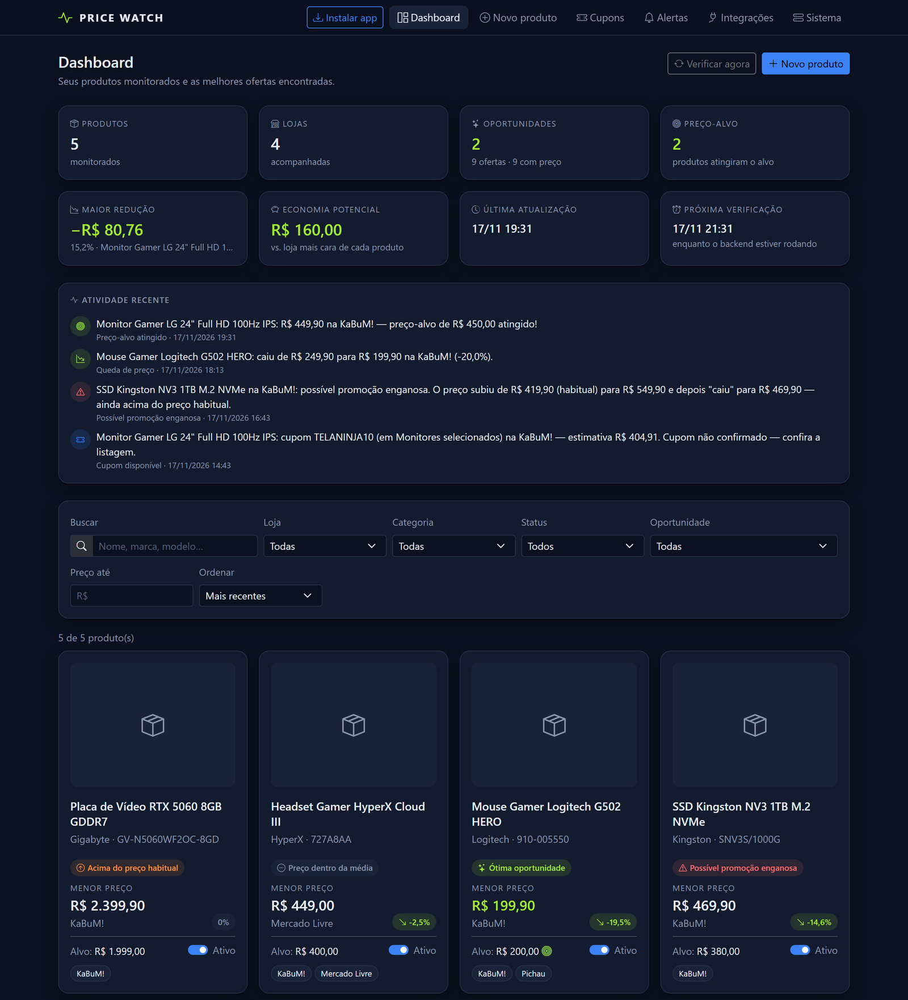
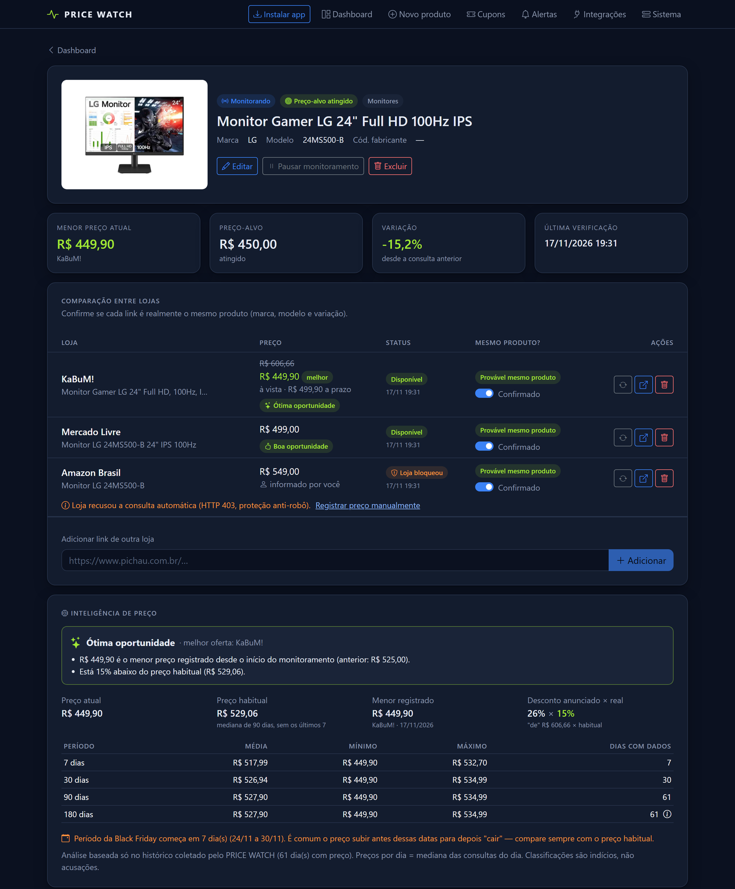
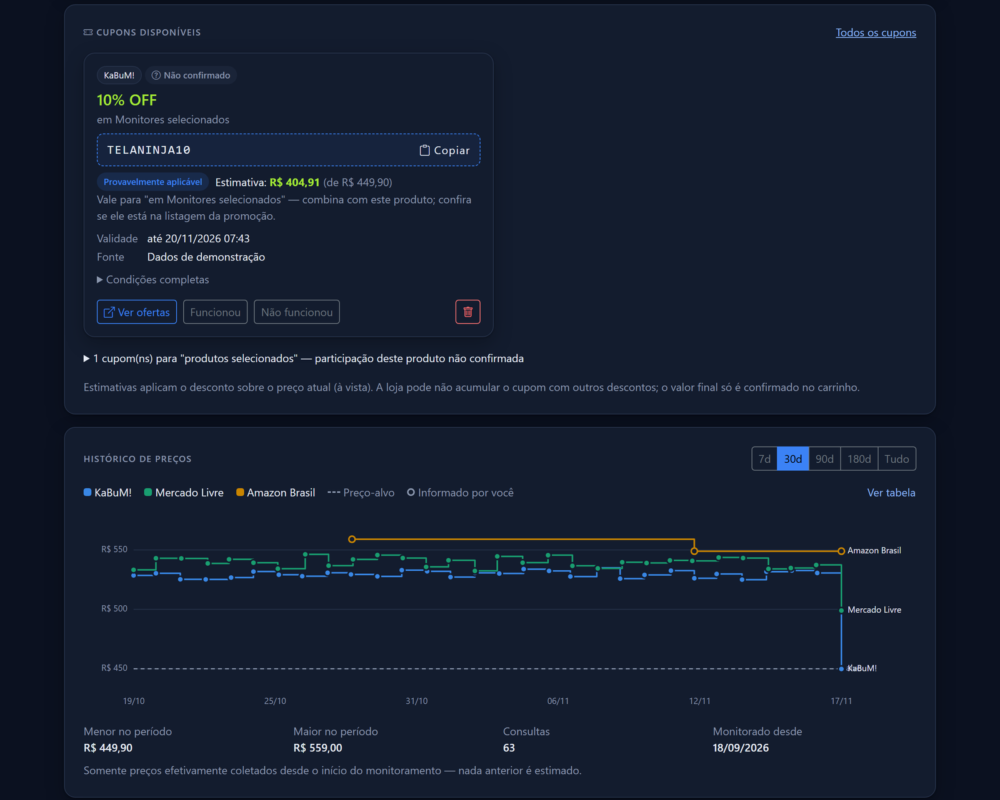
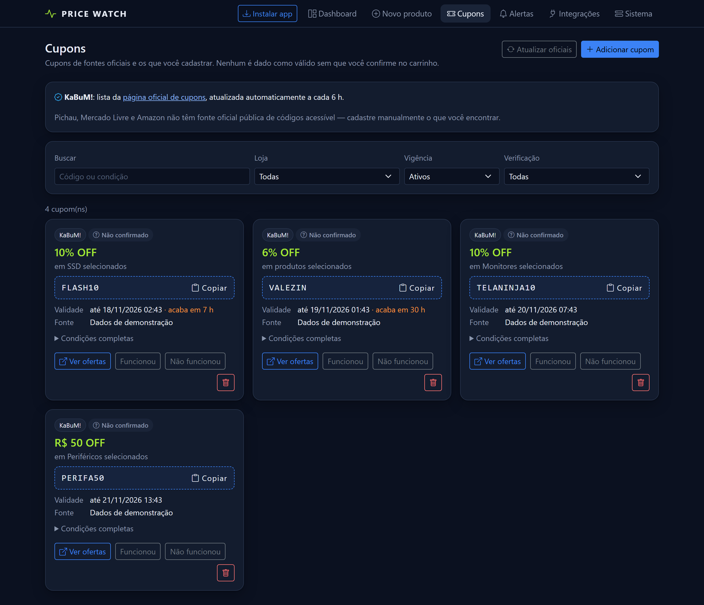
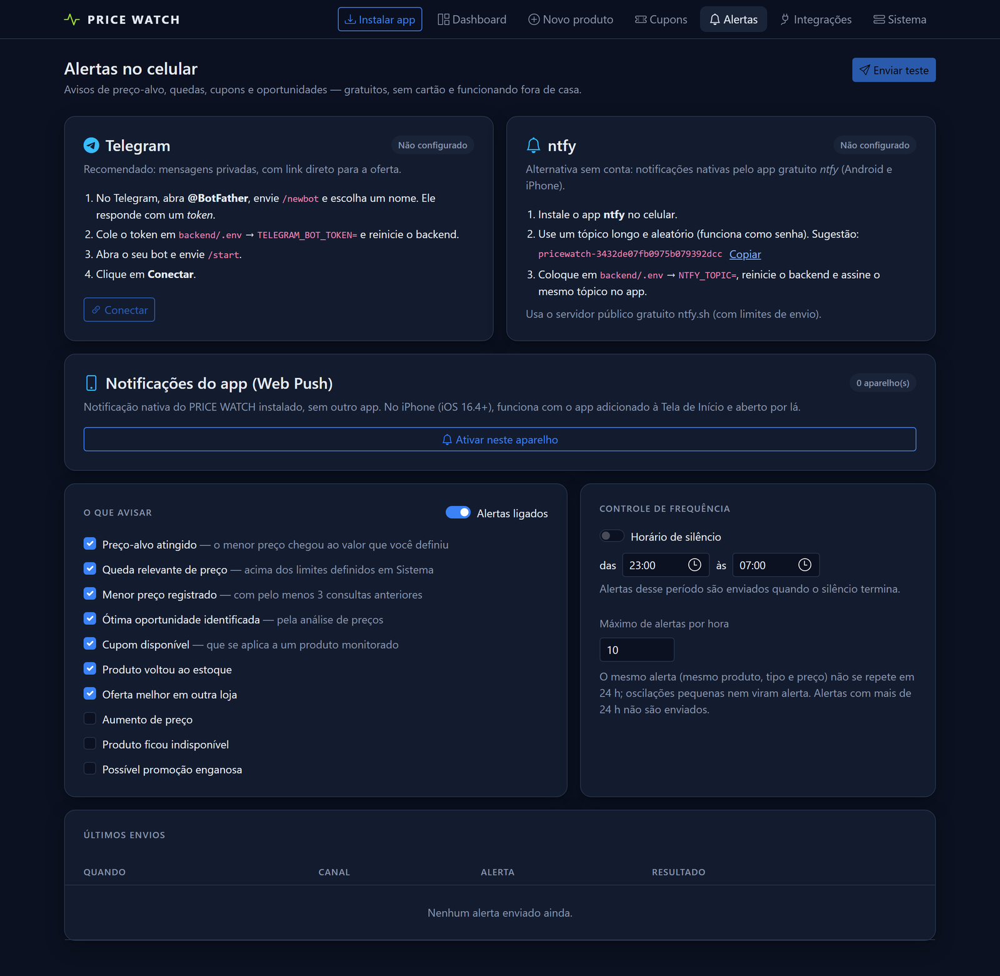
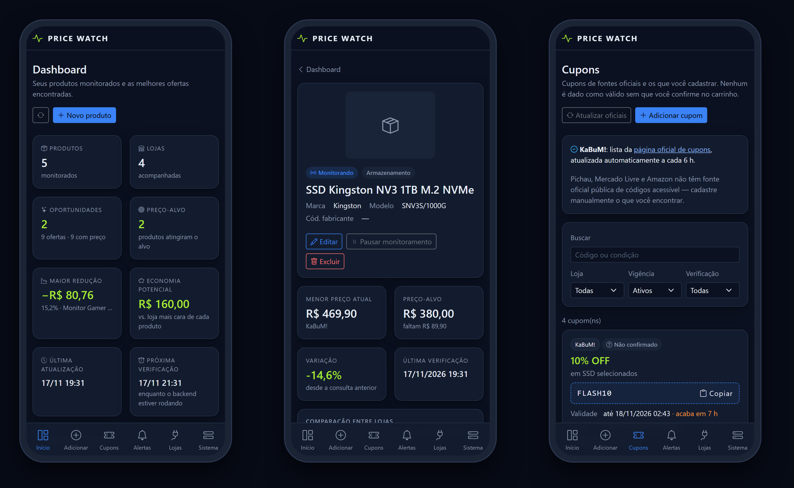
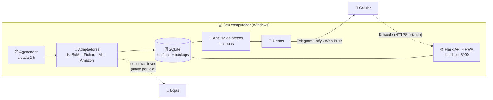

<div align="center">


# PRICE WATCH

**Seu assistente pessoal de compras: monitora preços em várias lojas, desmascara promoções falsas,<br/>encontra cupons e avisa no celular — rodando no seu próprio computador, sem custo nenhum.**


[Destaques](#-destaques) · [Capturas](#-capturas) · [Como funciona](#-como-funciona) · [Início rápido](#-início-rápido) · [Celular](#-no-celular) · [Guia completo](docs/GUIA.md)

<br/>



<sub>Capturas de tela com dados de demonstração.</sub>

</div>

---

## ✨ Destaques

| | |
|---|---|
| 🔗 **Cadastro pelo link** | Cole o link do produto e o app preenche nome, marca, modelo, imagem, categoria, preço à vista, a prazo e o preço "de". |
| 🏪 **Várias lojas, um produto** | KaBuM!, Pichau, Mercado Livre e Amazon lado a lado, com sugestão de correspondência (você confirma). |
| ⏱️ **Monitoramento automático** | Verifica a cada 2 h (ajustável), retoma sozinho depois que o PC liga e nunca perde o histórico. |
| 🕵️ **Promoções enganosas** | Compara o preço atual com o **preço habitual** coletado e aponta "subiu para depois cair" e preço "de" inflado — sempre explicando o porquê. |
| 🎟️ **Cupons** | Lê a página oficial de cupons da KaBuM!, mostra se vale para o seu produto e estima o preço final. Nada é dado como válido sem você confirmar. |
| 🔔 **Alertas no celular** | Telegram, ntfy ou Web Push: preço-alvo atingido, queda relevante, menor preço registrado, cupom, volta ao estoque… com horário de silêncio e sem repetição. |
| 📱 **PWA de verdade** | Instalável no iPhone e no Android, funciona offline com os últimos dados e avisa quando há versão nova. |
| 💸 **Custo zero** | Sem hospedagem, sem assinatura, sem cartão de crédito. Seus dados ficam no seu computador. |

## 📸 Capturas

<table>
  <tr>
    <td width="50%"></td>
    <td width="50%"></td>
  </tr>
  <tr>
    <td align="center"><sub><b>Comparação entre lojas e inteligência de preço</b></sub></td>
    <td align="center"><sub><b>Cupons aplicáveis e histórico por loja</b></sub></td>
  </tr>
  <tr>
    <td width="50%"></td>
    <td width="50%"></td>
  </tr>
  <tr>
    <td align="center"><sub><b>Cupons com código para copiar</b></sub></td>
    <td align="center"><sub><b>Alertas no celular: canais e preferências</b></sub></td>
  </tr>
</table>

<div align="center">
  
  <br/><sub><b>No celular, instalado na tela inicial</b></sub>
</div>

## 🕵️ Promoção de verdade ou "metade do dobro"?

O PRICE WATCH só usa preços que **ele mesmo coletou** — nada anterior ao início do monitoramento é inventado.
Com isso, calcula o preço habitual (mediana diária, ignorando a última semana) e compara:

| Momento | Preço |
|---|---:|
| 30 dias atrás | R$ 899,00 |
| 20 dias atrás | R$ 899,00 |
| 10 dias atrás | R$ 1.199,00 |
| **Hoje ("de R$ 1.199 por R$ 999")** | **R$ 999,00** |

> ⚠️ **Possível promoção enganosa** — o preço subiu de R$ 899,00 (habitual) para R$ 1.199,00 e depois "caiu" para
> R$ 999,00, ainda acima do preço habitual. Desconto anunciado: 17% · desconto real: nenhum.

Classificações: **Ótima oportunidade · Boa oportunidade · Preço dentro da média · Acima do habitual ·
Desconto pouco vantajoso · Possível promoção enganosa · Dados insuficientes** — cada uma com o motivo em texto.

## 🧭 Como funciona



| Loja | Como o preço é obtido | Situação |
|---|---|---|
| **KaBuM!** | Dados publicados na própria página do produto | ✅ Automático (à vista, a prazo e preço "de") + cupons oficiais |
| **Mercado Livre** | API oficial, com um app gratuito seu | ⚙️ Automático após configurar as credenciais |
| **Amazon** | Página do produto (bloqueia robôs) | ✍️ Preço manual, identificado no histórico |
| **Pichau** | Página do produto (bloqueia robôs) | ✍️ Preço manual, identificado no histórico |

> O PRICE WATCH **não contorna** proteções anti-robô: faz no máximo 1 consulta a cada 5 s por loja e pausa 30 min se a
> loja bloquear. Quando não consegue consultar, diz exatamente o motivo — e nunca inventa preço.

## 🚀 Início rápido

Pré-requisitos: **Windows**, **Python 3.10+** e **Node.js 24**.

```powershell
git clone https://github.com/SouzaKaique/PriceWatch.git
cd PriceWatch
```

```powershell
# Backend
cd backend
python -m venv .venv
.\.venv\Scripts\pip install -r requirements.txt
Copy-Item .env.example .env
cd ..
```

```powershell
# App (compila uma vez)
cd frontend
npm install
npm run build
cd ..
```

```powershell
# Rodar (API + app + monitoramento)
backend\.venv\Scripts\python backend\run.py
```

Abra **http://localhost:5000**, cole o link de um produto em **Novo produto** e pronto.

<details>
<summary><b>Rodar em segundo plano e iniciar com o Windows</b></summary>

```powershell
scripts\iniciar-backend.bat                                                   # sem janela; logs em backend\instance\pricewatch.log
powershell -ExecutionPolicy Bypass -File scripts\parar-backend.ps1
powershell -ExecutionPolicy Bypass -File scripts\instalar-inicio-automatico.ps1   # inicia ao entrar no Windows (sem admin)
```
</details>

<details>
<summary><b>Modo desenvolvimento</b></summary>

Backend como acima e, em outro terminal, `npm start` na pasta `frontend` → http://localhost:4200 (com recarregamento automático).
</details>

## 📱 No celular

Para instalar o app e receber notificações, o celular precisa de HTTPS. A forma gratuita e privada é o
[Tailscale](https://tailscale.com) (plano pessoal grátis): uma rede só entre os seus aparelhos — nada fica exposto na internet.

1. Instale o Tailscale no PC e no celular, com a mesma conta, e ative **MagicDNS** e **HTTPS** no painel.
2. No PC: `tailscale serve --bg 5000`
3. No celular, abra o endereço `https://…ts.net` → **Adicionar à Tela de Início** (iPhone) ou **Instalar app** (Android).
4. No app: **Alertas → Ativar neste aparelho**.

## 🔔 Alertas

| Canal | Custo | Para quem |
|---|---|---|
| **Telegram** | grátis | Recomendado: bot criado por você no @BotFather, mensagens com link para a oferta |
| **ntfy** | grátis, sem conta | Notificação nativa pelo app ntfy, sem cadastro |
| **Web Push** | grátis | Notificação do próprio app instalado (via Tailscale) |

```
PRICE WATCH — Oportunidade encontrada!

Seu Monitor LG UltraGear está custando R$ 749,90 na KaBuM!.
Preço desejado: R$ 750,00.
O preço-alvo foi atingido!

Toque para conferir a oferta
```

## 🛡️ Estável e privado

- **Tudo local:** banco SQLite no seu PC, API ouvindo só em `127.0.0.1`, tokens no `.env` (nunca enviados ao navegador).
- **Resiliente:** queda de energia no meio de uma verificação não perde dados; ao religar, a retomada é automática.
- **Backups diários** do banco (7 últimos), verificação de integridade a cada início e **diagnóstico** na tela Sistema
  ou com `python backend\diagnostico.py`.
- **Testado:** 98 testes no backend e 10 no frontend — lojas fora do ar, bloqueios, captcha, timeouts, reinício,
  backups, alertas e Web Push — sem acessar a internet.

```powershell
backend\.venv\Scripts\pip install -r backend\requirements-dev.txt
cd backend; .\.venv\Scripts\python -m pytest
cd ..\frontend; npx ng test --watch=false
```

## 🧱 Tecnologias

**Frontend:** Angular 21 (standalone, signals, zoneless) · Bootstrap 5 · SCSS · Angular Service Worker · gráficos em SVG próprio<br/>
**Backend:** Python · Flask · SQLAlchemy · APScheduler · Requests · BeautifulSoup · pywebpush<br/>
**Dados:** SQLite (WAL) · backups automáticos

## 🗺️ Roadmap

- [x] Estrutura, interface e cadastro por link
- [x] Integrações (KaBuM!, Mercado Livre via API oficial, Amazon e Pichau com preço manual)
- [x] Monitoramento automático e histórico
- [x] Inteligência de preços e promoções enganosas
- [x] Cupons
- [x] Alertas no celular (Telegram, ntfy, Web Push)
- [x] PWA instalável e offline
- [x] Testes e estabilidade
- [ ] Novas lojas (TerabyteShop, Magazine Luiza, Casas Bahia…) — a arquitetura de adaptadores já está pronta

## 📚 Documentação

O [**Guia completo**](docs/GUIA.md) cobre configuração do Mercado Livre, alertas, uso no celular, regras de análise,
cupons, API REST, backups/restauração e solução de problemas.

---

<div align="center">
<sub>Projeto pessoal, sem fins comerciais e sem vínculo com as lojas citadas. Os preços vêm somente de consultas reais
(ou informados por você) — nenhum valor é estimado ou inventado.</sub>
</div>
